 

## 👋 About me

- 🛠️ **Product developer.** I ship MVPs fast and turn the ones that work into production systems. [nellkopya.com](https://nellkopya.com) went from MVP to a live e-commerce site this way.
- 🎮 **Game developer on the side.** I prototype mechanics until they're fun, from a C# Tower Defense to the browser game [Apoclimate](https://kedaybehzat.github.io/son-denge/).
- 🎓 4th-year **Software Engineering** student at Sakarya University, with an Erasmus+ semester at **Hochschule Aalen** (Germany).
- 🌱 Organizer of **Google Developer Groups on Campus** Sakarya.
- 💼 Open to **freelance and part-time** work: websites, e-commerce, MVPs and game prototypes.

## 🚀 Featured work

| Project | What it is | Stack |
| --- | --- | --- |
| 🛒 **[nellkopya.com](https://nellkopya.com)** · `live` | Corporate e-commerce for a toner supplier: auth, inventory, cart, admin panel | Node.js · Express · React · PostgreSQL · Docker |
| 🌱 **[Apoclimate](https://kedaybehzat.github.io/son-denge/)** · `playable` | Climate-themed bunker management game set in 2071: balance energy, water, food, waste and carbon | Phaser · JavaScript |
| 🧭 **[timucin.site](https://timucin.site)** · `live` | My portfolio, with an SVG motion layer and a TR/EN toggle | HTML · CSS · JS · Railway |
| 📈 **[GeneticAlgorithm](https://github.com/Timujaponya/GeneticAlgorithm)** | Genetic algorithm for algorithmic trading strategies | Python · Pandas |

## 🧰 Tech stack

  
   
  

## 📊 GitHub stats

  
  

