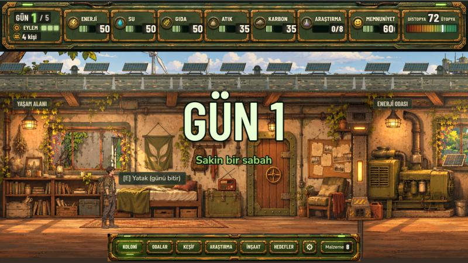

 

## 👋 About me

- 🛠️ **Product developer.** I ship MVPs fast and turn the ones that work into production systems. [nellkopya.com](https://nellkopya.com) went from MVP to a live e-commerce site this way.
- 🎮 **Game developer on the side.** I prototype mechanics until they're fun, from a C# Tower Defense to the browser game [Apoclimate](https://kedaybehzat.github.io/son-denge/).
- 🎓 4th-year **Software Engineering** student at Sakarya University, with an Erasmus+ semester at **Hochschule Aalen** (Germany).
- 🌱 Organizer of **Google Developer Groups on Campus** Sakarya.
- 💼 Open to **freelance and part-time** work: websites, e-commerce, MVPs and game prototypes.

## 🔭 Right now

- 🎙️ Running the 2026–27 season of **GDG on Campus Sakarya**: hackathons, tea talks and workshops
- 🎨 Polishing **[timucin.site](https://timucin.site)**: motion design, case studies and a themed CV
- 🛒 Taking on **freelance** website and e-commerce builds
- 🎓 Final year of Software Engineering at Sakarya University

## 🚀 Featured work

| Project | What it is | Stack |
| --- | --- | --- |
| 🛒 **[nellkopya.com](https://nellkopya.com)** · `live` | Corporate e-commerce for a toner supplier: auth, inventory, cart, admin panel | Node.js · Express · React · PostgreSQL · Docker |
| 🌱 **[Apoclimate](https://kedaybehzat.github.io/son-denge/)** · `playable` | Climate-themed bunker management game set in 2071: balance energy, water, food, waste and carbon | Phaser · JavaScript |
| 🧭 **[timucin.site](https://timucin.site)** · `live` | My portfolio, with an SVG motion layer and a TR/EN toggle | HTML · CSS · JS · Railway |
| 📈 **[GeneticAlgorithm](https://github.com/Timujaponya/GeneticAlgorithm)** | Genetic algorithm for algorithmic trading strategies | Python · Pandas |

## 🎮 Game showcase

**Apoclimate** · Yeşilvadi, 2071. After the Great Silence, keep a climate bunker alive for 5 days: balance energy, water, food, waste and carbon, keep residents rested and trusting, and decide who gets in when someone knocks. Easy fixes come with a carbon price.

## 💼 Services

| | Service | What you get | From |
| :---: | --- | --- | ---: |
| 🌐 | **Business website** | Custom design, SEO basics, WhatsApp, maps & contact form · 1–2 weeks | ₺15,000 |
| 🛒 | **E-commerce** | Products, stock, cart, orders, payments & an admin panel · 3–5 weeks | ₺40,000 |
| 🚀 | **MVP / web app** | Core feature first, built to scale if it works · 2–6 weeks | ₺30,000 |
| 🎮 | **Game prototype** | Playable core mechanic with weekly builds · 2–4 weeks | ₺20,000 |
| 🛠️ | **Care & hosting** | Hosting, domain, SSL, backups & small edits | ₺1,500/mo |

&nbsp;Fixed quote after a free 30-minute call.

## 📅 GDG on Campus Sakarya · latest events

<!-- GDG-EVENTS:START -->
- ✅ `27 Oct 2026` · [Hackathon](https://gdg.community.dev/events/details/google-gdg-on-campus-sakarya-universitesi-sakarya-turkiye-presents-gdg-on-campus-sakarya-university-hackathon/)
- ✅ `16 Oct 2026` · [Tea Talk](https://gdg.community.dev/events/details/google-gdg-on-campus-sakarya-universitesi-sakarya-turkiye-presents-gdg-on-campus-sakarya-university-tea-talk/)
- ✅ `06 Oct 2026` · [GDG on Campus Sakarya Üniversitesi ile tanış!](https://gdg.community.dev/events/details/google-gdg-on-campus-sakarya-universitesi-sakarya-turkiye-presents-gdg-on-campus-sakarya-universitesi-ile-tanis/)
<!-- GDG-EVENTS:END -->

Updated daily by a GitHub Action from the [chapter page](https://gdg.community.dev/gdg-on-campus-sakarya-universitesi-sakarya-turkiye/).

## 🧰 Tech stack

  
   
  

## 📊 GitHub stats

  
  

